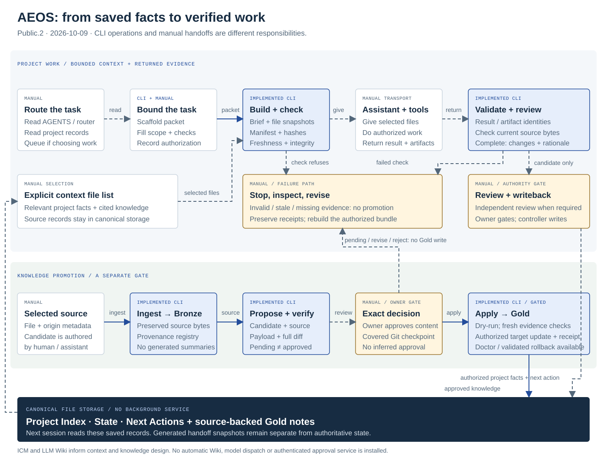

# AEOS — Agentic Engineering OS

A source preview for independent builders coordinating ongoing work with AI. Keep current project facts in files, prepare bounded context, inspect the returned evidence and continue in a fresh session.

This repository contains neutral templates, reusable tools and an authored synthetic sample. It contains no personal operating vault, private project context, account configuration or user history.

## Try it

Download the current [public.4 setup archive](site/downloads/agentic-engineering-os-2026.10.17-public.4.zip), or use the [unpacked package](distribution/agentic-engineering-os-2026.10.17-public.4/README.md). Follow its [FIRST_RUN.md](distribution/agentic-engineering-os-2026.10.17-public.4/FIRST_RUN.md). The demo ingests a source, creates a pending knowledge proposal, prepares a handoff, checks a sample result and rejects stale or missing context. It makes no model calls and does not apply Gold knowledge.

Requires Python 3.11+ (tested on 3.11.15 and 3.14.5 on Windows). Install the package's documented requirements into a fresh virtual environment. Git is needed for the Librarian's approved apply/rollback path. Other platforms and provider handoffs are unverified.

## How research becomes trusted knowledge

**Bronze** keeps raw source material and where it came from. An agent can collect it, but source text is evidence, not instructions. **Silver** is a proposed knowledge note drafted from Bronze with its source, diff and checks; it remains unapproved. The **owner decision** is a human accepting, editing or rejecting that exact proposal. **Gold** is the approved note applied to the project's trusted knowledge after the required fresh checks and Git checkpoint. Agents can prepare Bronze and Silver; only the owner can authorize Gold. The synthetic demo stops at pending Silver.

## Explore the system

- [Architecture and usage flow](docs/ARCHITECTURE.md) — real file contracts, commands and manual handoffs
- [Designed system preview](site/architecture.html) — offline architecture and workflow diagrams
- [Ecosystem analysis and benchmarks](docs/ECOSYSTEM.md) — inclusion decisions, sources and proposed experiments
- [Adopting AEOS in a team](docs/ADOPTING-AEOS.md) — any assistant, protections, roles, sequenced work and datasets
- [First run](site/first-run.html)
- [Capabilities and verification](site/verification.html)
- [Source credits](site/sources.html)
- [Current public.4 verification receipt](site/verification-public.4.json)

To view the site locally, run `python -m http.server 4396 --bind 127.0.0.1 --directory site` from this repository and open http://127.0.0.1:4396. Serve only site/, never a personal workspace. The HTML files also open locally.

An owner-private guided walkthrough Site also exists. It requires owner access, so its login-gated URL is omitted from this public README.

The tools prepare and check files; assistant handoffs are manual. No autonomous team, model runtime, provider authentication, native sandbox or hosted service is installed. Mechanical verification, independent review, owner acceptance and release remain distinct.

This is a public source preview, not a paid product release. Pricing, commercial license/distribution terms and support are unset. No open-source license or support commitment is asserted. See the package TERMS-DRAFT.md and SOURCES.md. The repository publication does not deploy the website.

## Authorship and rights

Created by Zachary Hatch. Copyright (c) 2026 Zachary Hatch. All rights reserved.

See [LICENSE](LICENSE) for the copyright and rights notice. Source credits identify influences and separately installed third-party dependencies; they do not transfer authorship of AEOS or imply endorsement.

## Historical records

- [Public.3 archive](distribution/agentic-engineering-os-2026.10.09-public.3.zip), [first-run guide](distribution/agentic-engineering-os-2026.10.09-public.3/FIRST_RUN.md) and [historical receipt](site/verification-public.3.json) are frozen. Its guide pins CPython 3.14.5; public.4 carries the tested 3.11 compatibility update.
- [Public.2 archive](distribution/agentic-engineering-os-2026.10.09-public.2.zip) and [historical receipt](site/verification-public.2.json) remain unchanged. Its bundled FIRST_RUN has a known relative-output defect.
- [Public.1 archive](distribution/agentic-engineering-os-2026.10.08-public.1.zip) and [historical receipt](site/verification.json) remain unchanged.
- The [public.4-candidate.1 archive](distribution/agentic-engineering-os-2026.10.12-public.4-candidate.1.zip) is a separate, unpublished public.2-lineage repair candidate. Its [candidate record](docs/PACKAGE-CANDIDATE.md) and [October 14 readiness reconciliation](docs/RELEASE-READINESS-public.4.md) are historical and do not describe the current public.3-derived release.
