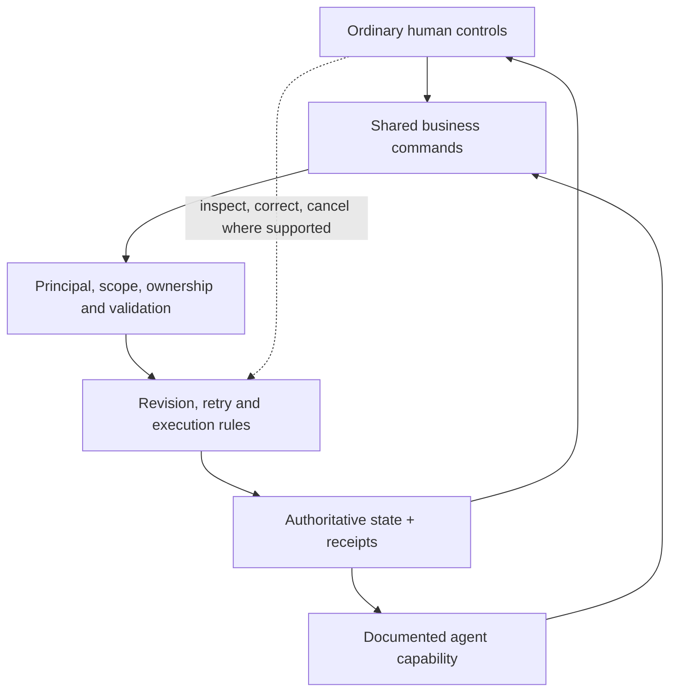

# Human-usable and agent-native feature standard

**Required for every new or materially changed feature.** A person can use it
normally, an agent can use it through a documented capability, and both operate
through the same application rules. This is an acceptance contract, not a claim
that existing features already meet it.

Build one application core with ordinary human controls and documented agent
adapters. Both call the same business commands, validation, authorization and
durable state. API, CLI, SDK and MCP are adapter choices; adding an agent framework
or a model inside every application is not required. A file-based application can
use guarded commands. Direct arbitrary database or filesystem access is not a
business capability.

## Required acceptance gates

For each capability record **PASS, FAIL, PARTIAL, NOT RUN**, or **NOT APPLICABLE
with a reason**, plus exact source/test evidence and its environment. Do not
average failed gates into a passing score. An applicable FAIL, PARTIAL or NOT RUN
prevents claiming feature completion under this standard; a bounded experiment can
remain a clearly labeled candidate. Existing accepted milestones retain their
history and are audited separately, not retroactively erased.

| Requirement | Proof required |
|---|---|
| Shared capabilities | Human controls and the documented agent adapter invoke the same business command and validation; equivalent authorized input yields equivalent business results. |
| Shared state | Writes through either path appear in the other after refresh/reconnect and restart, with authoritative revision and scoped context. |
| Scoped authority | Application code resolves the verified principal and represented user, enforces grants, resource ownership and expiry, and rejects cross-user/ungranted access before effects. Human-only approvals stay human-only. |
| Human usability | Essential tasks work with AI disabled through ordinary controls, keyboard/navigation and understandable errors; the intended product interface remains usable. |
| Visible supervision | People can see what may be delegated, proposed changes, active work, outcomes and errors; deny, cancel or take over at documented boundaries where supported. |
| Safe recovery | Same scoped retry key and payload yields one effect; key/payload mismatch refuses; stale revisions conflict; Undo/compensation cannot overwrite a newer valid edit. Irreversible effects and partial outcomes are explicit. |
| Receipts | State and receipt commit consistently; actor/delegation, operation, target, safe input summary, before/after revision, outcome and recovery are recorded without credentials or hidden reasoning. |

Parity means equivalent capabilities **within authorized roles**, not identical
privileges or one tool for every button. An agent may prepare a payment while only
a human may approve it. Selecting a UI item supplies context, not permission.
Imported notes, websites and model output cannot increase authority. Where the
current system cannot verify identity, expose that limitation; do not turn a
copied actor label, approval field or receipt into authenticated authorization.

## Capability contract

Before implementation document:

- Stable capability name/version, typed inputs/outputs and read/write classification.
- Human control, agent invocation and shared handler; authoritative storage and relevant scoped context.
- Server/application-resolved actor, represented user, role, resource boundary, grants and expiry.
- Validation, expected revision, structured conflicts and current-state preconditions.
- Scoped idempotency key, payload identity, retention window and behavior after expiry.
- Preview and approval requirements; exact effect boundary; timeout, job and cancellation semantics.
- Receipt schema, recovery/Undo preconditions and irreversible/uncertain outcome handling.

Return a committed result or a real job ID with state and receipt references.
Queued is not completed. Bind human approvals to exact targets, parameters/diff,
revision, principal and expiry; recheck at execution. An agent cannot mint approval
or reuse a changed proposal's approval. Retries after lost responses retrieve the
original result rather than repeating effects.

Receipts provide auditability, **not guaranteed model replay**. Keep predictable
validation and execution in application code; evaluate model choices separately.
Replay fixtures only in isolation without resending messages, payments or other
real effects. Declare recovery limits rather than promising universal Undo or
instant cross-interface awareness.

## Minimum verification

Use synthetic local/test storage with production connections explicitly excluded.

1. Complete the essential human workflow without AI, then equivalent authorized
   input through the documented tool; compare saved results and shared validation.
2. Verify changes in both interfaces and after restart/reconnect; test scoped read
   context and revision, denied cross-user access, ungranted/expired authority.
3. Repeat the same scoped request; test one effect, lost response recovery,
   payload mismatch and retention expiry behavior.
4. Race a human edit with a stale agent write; preserve the newer state. Exercise
   conflict-safe Undo and state/receipt atomic failure behavior.
5. Inspect proposed/active/completed/failed states, human-only decisions and
   cancellation/takeover boundaries where applicable. Mark live model/platform,
   hosted and real-user checks NOT RUN unless actually performed.

Documentation-only or infrastructure changes may justify inapplicable product
gates individually; this cannot waive ownership, permission or recovery checks
for a feature that changes user data. A UI screenshot, schema or existing API
alone is insufficient parity proof. Follow the project's current verification,
independent review and release gates; this standard grants no external action.

## Sources and status

Owner-adopted AEOS engineering policy; these references inform the design, not an
endorsement or certification. Checked 2026-10-10:

- [Anthropic: Writing effective tools for agents](https://www.anthropic.com/engineering/writing-tools-for-agents) — purposeful tools, outcome evaluation, deterministic tools versus nondeterministic agents.
- [Microsoft HAX guidelines](https://www.microsoft.com/en-us/haxtoolkit/ai-guidelines/) — understandable capabilities, human control and correction.
- [Stripe idempotent requests](https://docs.stripe.com/api/idempotent_requests) — an example retry contract; an application's own retention and error rules must be explicit.

Adoption of this policy does not implement any adapter, authenticate a principal,
install a runtime, rerun historical tests or authorize publication/deployment.

