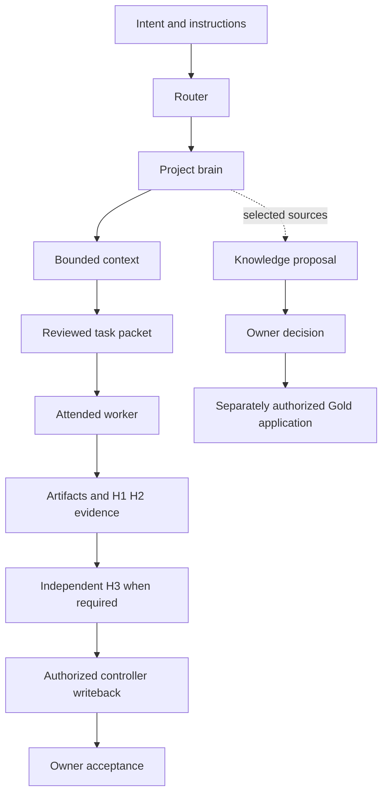

# Stack roles and connections

The table describes roles a deployment may assign. It does not assert that these products are installed, connected or tested by the public package. Transport to assistants is manual unless a separately assessed adapter supplies it. See [implemented contracts](ARCHITECTURE.md).

| Component | Role | Reads and returns |
|---|---|---|
| Claude Code | Optional coding worker or separate reviewer | Approved packet and selected files; scoped diff and evidence |
| Codex | Optional controller, coding worker or separate reviewer | Current instructions and packet; artifacts, checks and integration proposals |
| T3 Code | Optional orchestration host | Bounded task and host-supported delegation; child results and review evidence |
| Grok | Optional research or worker surface | Selected sources and packet; cited synthesis or task result |
| ChatGPT | Optional planning and synthesis surface | Reviewed context; draft plans, questions and proposals |
| GitHub | Authorized collaboration surface | Branch changes; draft PR and review records |
| Obsidian | Optional interface to durable Markdown | Canonical notes; human edits and navigation |
| MCP connectors | Optional tool adapters | Explicit scoped requests; tool results subject to host permissions |
| Runner v1 | Attended file harness | Approved task packet; bounded handoff and result records |
| H3 verification | Independent review function | Diff, acceptance criteria and evidence; verdict and findings |
| Private read-only dashboard | Optional projection for inspection | Selected canonical facts; freshness-labelled views, never task authority |
| Execution kernel | Artifact and lifecycle design | Run artifacts and decisions; local ledger and replay descriptions where implemented |
| Knowledge librarian | Governed knowledge workflow | Source and proposal; Bronze, Silver, owner decision and separately authorized Gold application |

One product may perform several roles, but a worker cannot independently verify its own result. Product names do not confer authority, authentication or compatibility.

This is a procedural flow. Arrows do not promise automated dispatch. The [Mermaid source](diagrams/stack-loop.mmd) is editable. The public package's ledger records Librarian events; it is not a general scheduler, authenticated approval service or guarantee of model replay.
